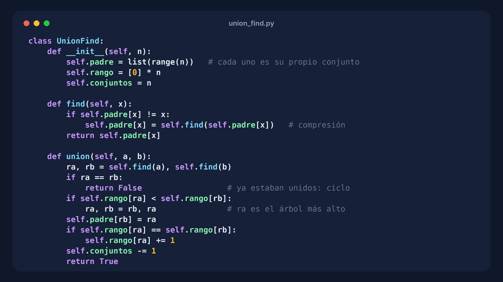
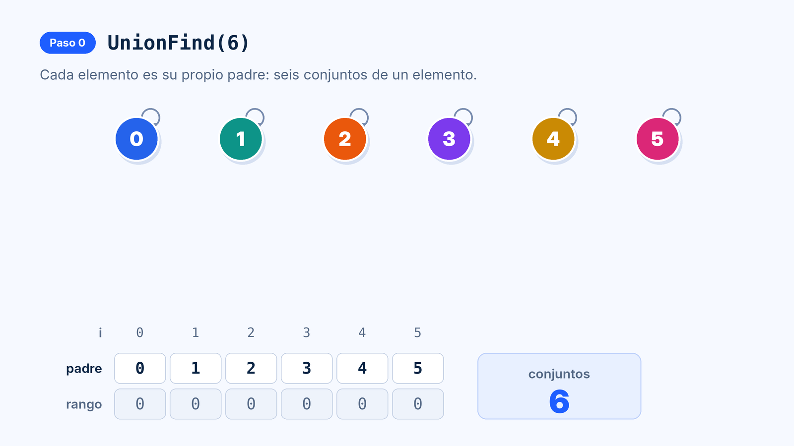
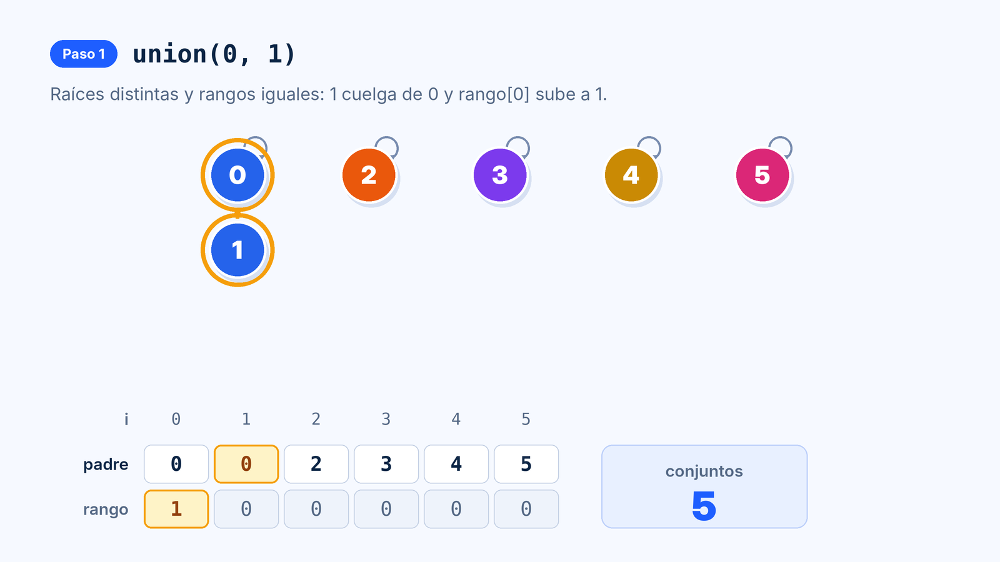
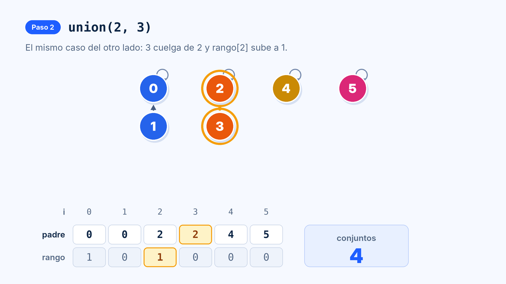
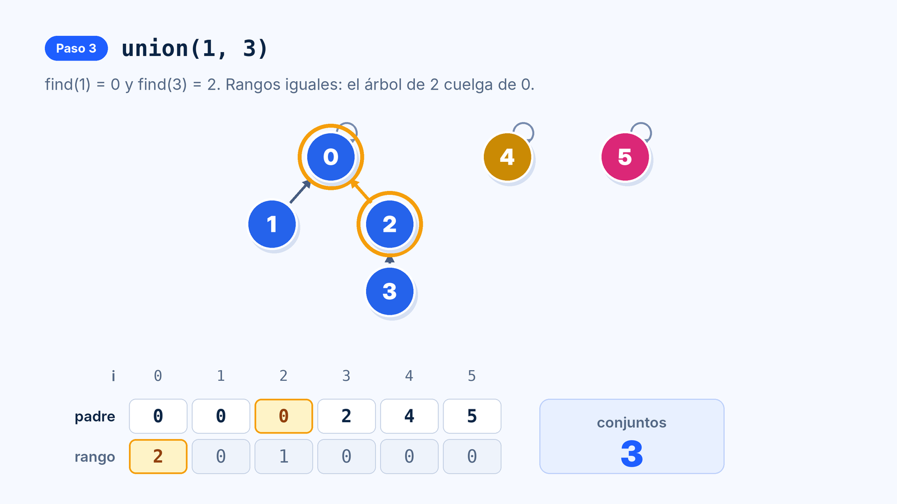
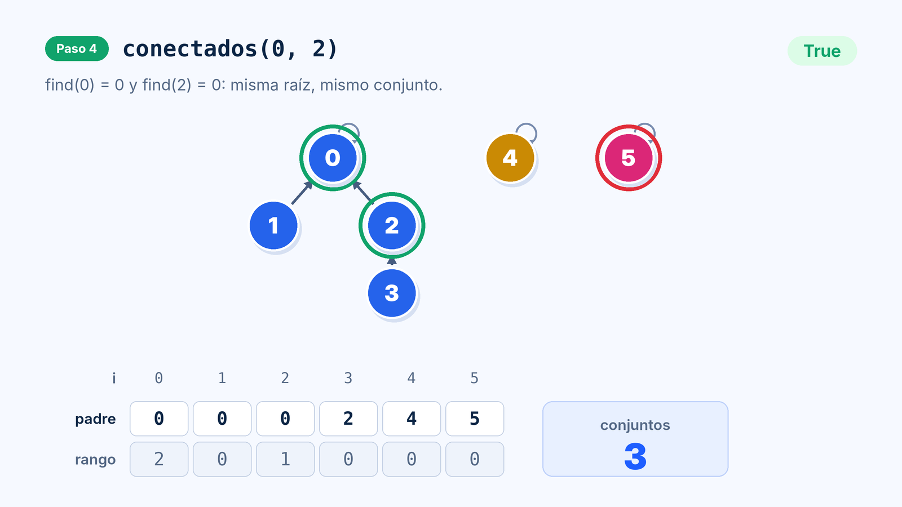
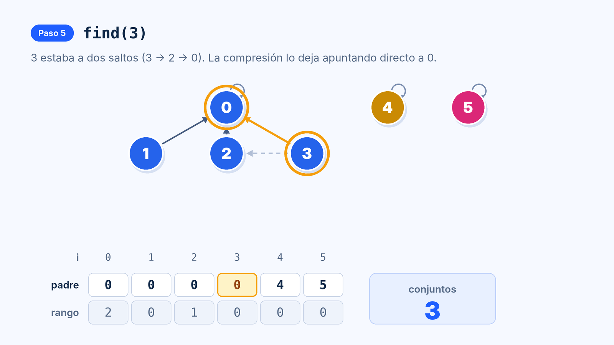
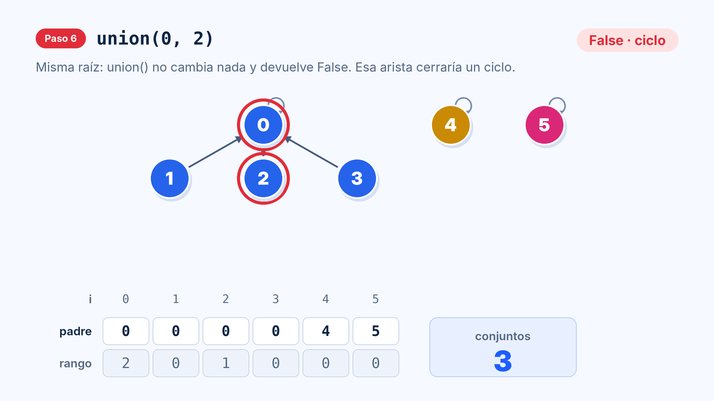
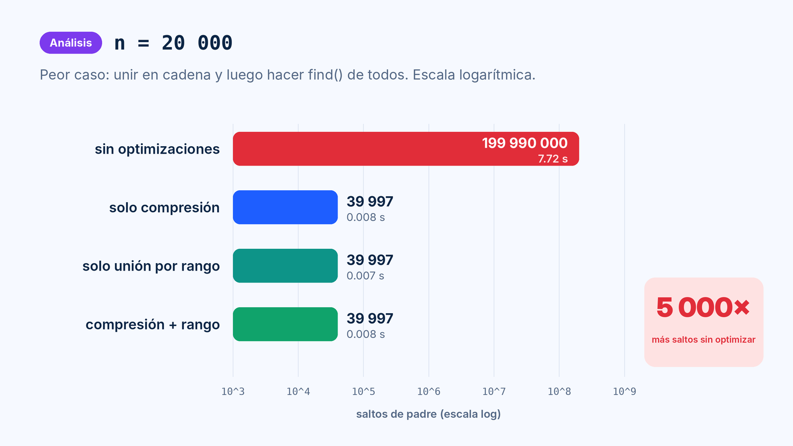
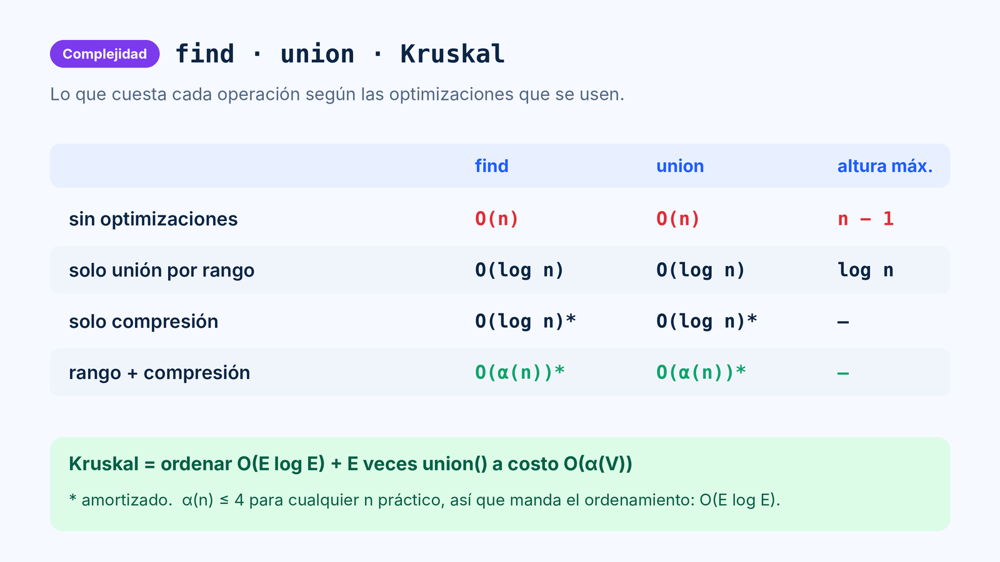

# Union-Find y Kruskal

### Conjuntos disjuntos y árbol de expansión mínima

**Estructuras de Datos y Algoritmos II** · Semestre 2027-1 · Exposiciones finales, Tema 4
**Profesor:** Daniel Vargas

** Presentacion : https://canva.link/bp6d7y4sz90zyc5 ** 

---

## Integrantes


| Nombre                 | Número de cuenta | Parte de la exposición |
|---|---|---|
|Bolaños Fuentes Juan Manuel|323257419|Demostracion y Analisis|
|Prado Gutierrez Juan Alejandro |323156271|Demo y explicacion de algoritmo|
| | | |
| | | |

---

## Contenido

1. [Teoría]
2. [Demo]
3. [Análisis de resultados]
4. [Conclusiones]
5. [Referencias]
---


# Parte 1 · Teoría

> ✏️ **Por completar.** Qué es Union-Find, cómo funcionan `find` y `union`,
> las dos optimizaciones (unión por rango y compresión de caminos) y la idea de
> Kruskal con su pseudocódigo.

---

# Parte 2 · Demo

## 2.1 El código

La implementación está en [`src/union_find.py`](src/union_find.py).



```python
class UnionFind:
    def __init__(self, n):
        self.padre = list(range(n))   # cada elemento es su propio conjunto
        self.rango = [0] * n
        self.conjuntos = n

    def find(self, x):
        """Devuelve la raíz del conjunto, con compresión de caminos."""
        if self.padre[x] != x:
            self.padre[x] = self.find(self.padre[x])
        return self.padre[x]

    def union(self, a, b):
        """Une dos conjuntos por rango. Devuelve False si ya estaban unidos."""
        ra, rb = self.find(a), self.find(b)
        if ra == rb:
            return False
        if self.rango[ra] < self.rango[rb]:
            ra, rb = rb, ra
        self.padre[rb] = ra
        if self.rango[ra] == self.rango[rb]:
            self.rango[ra] += 1
        self.conjuntos -= 1
        return True 

    def conectados(self, a, b):
        return self.find(a) == self.find(b)

    def __repr__(self):
        return str(self.padre)

```

## 2.2 La demo paso a paso

Se crean seis elementos, del `0` al `5`. En cada tabla, **en negrita** lo que
cambia respecto al paso anterior.

### Paso 0 · `UnionFind(6)`



| i | 0 | 1 | 2 | 3 | 4 | 5 | conjuntos |
|---|:---:|:---:|:---:|:---:|:---:|:---:|:---:|
| `padre` | 0 | 1 | 2 | 3 | 4 | 5 | **6** |
| `rango` | 0 | 0 | 0 | 0 | 0 | 0 | |

Cada elemento es su propio padre: seis conjuntos de un elemento.

### Paso 1 · `union(0, 1)`



1. `find(0) = 0` y `find(1) = 1`. Raíces distintas.
2. `rango[0] = rango[1] = 0`, así que no hay intercambio.
3. `padre[1] ← 0`, y como los rangos eran iguales, `rango[0]` sube a `1`.

| i | 0 | 1 | 2 | 3 | 4 | 5 | conjuntos |
|---|:---:|:---:|:---:|:---:|:---:|:---:|:---:|
| `padre` | 0 | **0** | 2 | 3 | 4 | 5 | **5** |
| `rango` | **1** | 0 | 0 | 0 | 0 | 0 | |

### Paso 2 · `union(2, 3)`



El mismo caso del otro lado: `padre[3] ← 2` y `rango[2]` sube a `1`.

| i | 0 | 1 | 2 | 3 | 4 | 5 | conjuntos |
|---|:---:|:---:|:---:|:---:|:---:|:---:|:---:|
| `padre` | 0 | 0 | 2 | **2** | 4 | 5 | **4** |
| `rango` | 1 | 0 | **1** | 0 | 0 | 0 | |

### Paso 3 · `union(1, 3)` · aquí se ve por qué `union` llama a `find`



1. `find(1)` sube `1 → 0`, así que `ra = 0`.
2. `find(3)` sube `3 → 2`, así que `rb = 2`.
3. `rango[0] = rango[2] = 1`: no hay intercambio.
4. `padre[2] ← 0`: **el árbol de `2` completo** cuelga de `0`.
5. Los rangos eran iguales, así que `rango[0]` sube a `2`.

```
        0              4    5
       / \
      1   2
          |
          3       ← 3 sigue apuntando a 2: está a dos saltos de la raíz
```

| i | 0 | 1 | 2 | 3 | 4 | 5 | conjuntos |
|---|:---:|:---:|:---:|:---:|:---:|:---:|:---:|
| `padre` | 0 | 0 | **0** | 2 | 4 | 5 | **3** |
| `rango` | **2** | 0 | 1 | 0 | 0 | 0 | |

### Paso 4 · `conectados(0, 2)` y `conectados(0, 5)`



- `find(0) = 0` y `find(2) = 0`. Misma raíz, así que **`True`**.
- `find(0) = 0` y `find(5) = 5`. Raíces distintas, así que **`False`**.

Esta es exactamente la pregunta que Kruskal hace por cada arista. El arreglo no
cambia.

### Paso 5 · `find(3)` · la compresión de caminos



`3` estaba a dos saltos: `3 → 2 → 0`. La recursión llega a la raíz `0` y, al
regresar, reescribe `padre[3]` con la raíz.

| i | 0 | 1 | 2 | 3 | 4 | 5 | conjuntos |
|---|:---:|:---:|:---:|:---:|:---:|:---:|:---:|
| `padre` | 0 | 0 | 0 | **0** | 4 | 5 | 3 |
| `rango` | 2 | 0 | 1 | 0 | 0 | 0 | |

El árbol se aplanó solo. `conjuntos` no cambia porque los grupos son los mismos.
`rango[0]` sigue en `2` aunque la altura real ya es `1`: por eso el rango es una
**cota** de la altura y no la altura exacta.

### Paso 6 · `union(0, 2)` regresa `False`



`find(0) = 0` y `find(2) = 0`. Misma raíz: `union` corta en el primer `if` y
regresa **`False`** sin tocar nada.

**Este es el corazón de Kruskal.** Si `union` regresa `False`, la arista
cerraría un ciclo y se descarta.

### Salida completa

```
$ python src/union_find.py
Inicial:        [0, 1, 2, 3, 4, 5]  conjuntos=6
union(0,1):     [0, 0, 2, 3, 4, 5]  conjuntos=5
union(2,3):     [0, 0, 2, 2, 4, 5]  conjuntos=4
union(1,3):     [0, 0, 0, 2, 4, 5]  conjuntos=3
¿0 y 2 conectados? True
¿0 y 5 conectados? False
find(3):        [0, 0, 0, 0, 4, 5]  conjuntos=3
union(0,2) -> False
```

### Resumen de la traza

| Operación | `padre` | `rango` | conjuntos | Regresa |
|---|---|---|:---:|:---:|
| `UnionFind(6)` | `[0, 1, 2, 3, 4, 5]` | `[0, 0, 0, 0, 0, 0]` | 6 | — |
| `union(0, 1)` | `[0, `**`0`**`, 2, 3, 4, 5]` | `[`**`1`**`, 0, 0, 0, 0, 0]` | 5 | `True` |
| `union(2, 3)` | `[0, 0, 2, `**`2`**`, 4, 5]` | `[1, 0, `**`1`**`, 0, 0, 0]` | 4 | `True` |
| `union(1, 3)` | `[0, 0, `**`0`**`, 2, 4, 5]` | `[`**`2`**`, 0, 1, 0, 0, 0]` | 3 | `True` |
| `conectados(0, 2)` | sin cambio | sin cambio | 3 | `True` |
| `conectados(0, 5)` | sin cambio | sin cambio | 3 | `False` |
| `find(3)` | `[0, 0, 0, `**`0`**`, 4, 5]` | sin cambio | 3 | `0` |
| `union(0, 2)` | sin cambio | sin cambio | 3 | **`False`** |

## 2.3 Demo de Kruskal

> ✏️ **Por completar.** Implementación de Kruskal en `src/kruskal.py` usando la
> clase `UnionFind`, corriendo sobre el grafo de [`media/kruskal_grafo.png`](media/kruskal_grafo.png), con su salida.
> El MST esperado es { A–C, C–E, A–B, D–E, E–F } con peso 19.

---

# Parte 3 · Análisis de resultados

## 3.1 El experimento

El costo de `find` es la altura del árbol, así que hay que forzar el peor caso:
unir en cadena, `union(0,1)`, `union(1,2)`, `union(2,3)`… y luego hacer `find`
de todos los elementos.

[`src/benchmark.py`](src/benchmark.py) repite el experimento con las cuatro
combinaciones de optimizaciones y mide dos cosas:

- **Saltos de padre:** cuántas veces `find` sube un nivel. Es el trabajo real,
  independiente de la máquina.
- **Tiempo** en segundos.

```bash
python src/benchmark.py 20000
```

## 3.2 Resultados

`n = 20 000` elementos.

> ✏️ Correr el benchmark en la máquina del equipo y **sustituir estos números
> por los propios**. Los saltos deben salir iguales; el tiempo cambia según la
> computadora.

| Configuración | Saltos de padre | Tiempo |
|---|---:|---:|
| Sin optimizaciones | 199 990 000 | 7.72 s |
| Solo compresión de caminos | 39 997 | 0.008 s |
| Solo unión por rango | 39 997 | 0.007 s |
| Compresión + rango | 39 997 | 0.008 s |



## 3.3 Lectura de los resultados

- **Cinco mil veces menos trabajo.** De 200 millones de saltos a 40 mil. Sin
  optimizar, la suma de los `find` es `O(n²)`: `n(n − 1)/2 = 199 990 000`,
  exactamente lo medido. Con cualquier optimización baja a `O(n)`.
- **Con una sola optimización basta para este caso.** Con unión por rango la
  cadena nunca se forma; con compresión, el primer `find` la aplana.
- **Las dos juntas importan en secuencias adversarias**, donde una sola no
  alcanza. Juntas garantizan la cota `O(α(n))` de Tarjan y van Leeuwen.
- **Para Kruskal**, esto significa que detectar ciclos cuesta casi nada y el
  algoritmo queda dominado por ordenar las aristas, `O(E log E)`.

## 3.4 Complejidad

- **Union-Find**, por operación:
  - Sin optimizaciones: `O(n)`. El árbol puede ser una cadena.
  - Solo unión por rango: `O(log n)`. La altura nunca pasa de `log₂ n`.
  - Solo compresión de caminos: `O(log n)` amortizado.
  - **Las dos juntas: `O(α(n))` amortizado.** `α` es la inversa de la función de
    Ackermann; para cualquier `n` que quepa en una computadora, `α(n) ≤ 4`.
  - Espacio: `O(n)`, dos arreglos de `n` enteros.
- **Kruskal**:
  - Ordenar las aristas: `O(E log E)`.
  - `E` llamadas a `union`: `O(E · α(V))`, prácticamente `O(E)`.
  - **Total: `O(E log E)`.** Lo domina el ordenamiento, no la detección de ciclos.
  - Espacio: `O(V + E)`.



---

# Parte 4 · Conclusiones


---

## Referencias

- Cormen, T. H., Leiserson, C. E., Rivest, R. L. y Stein, C. *Introduction to
  Algorithms*. MIT Press. Capítulos de estructuras de datos para conjuntos
  disjuntos y de árboles de expansión mínima. *(Verificar el número de capítulo
  en la edición que use el equipo.)*
- Tarjan, R. E. y van Leeuwen, J. (1984). Worst-case analysis of set union
  algorithms. *Journal of the ACM*, 31(2), 245–281.
- Kruskal, J. B. (1956). On the shortest spanning subtree of a graph and the
  traveling salesman problem. *Proceedings of the American Mathematical
  Society*, 7(1), 48–50.
- Material del curso: Vargas, D. *Estructuras de Datos y Algoritmos II*,
  semestre 2027-1.
