# Union-Find y Kruskal

### Conjuntos disjuntos y árbol de expansión mínima

**Estructuras de Datos y Algoritmos II** · Semestre 2027-1 · Exposiciones finales, Tema 4
**Profesor:** Daniel Vargas

---

## Integrantes

| Nombre | Número de cuenta | Parte de la exposición |
|---|---|---|
| Bolaños Fuentes Juan Manuel | 323257419 | Análisis |
| Guadarrama Climaco Ivan Alexei | <!-- número de cuenta --> | |
| Miguel Cruz Edgar | 323012944 | Conclusiones |
| Prado Gutierrez Juan Alejandro | 323156271| Demo |

---

## Presentación y demo interactiva

- [Ver la presentación en Canva](https://www.canva.com/design/DAHbH8aB2Tk/JuhjAeXB62RFXUQYbMUKYQ/view)
- **[Demo interactiva](https://jmbf010907-ui.github.io/-Union-Find-y-Kruskal-/)**: los mismos pasos de la Parte 2, con botones para avanzar y retroceder, y un modo libre para hacer tus propios `union` y `find`. El código está en [`docs/index.html`](docs/index.html).

---

## Contenido

1. [Teoría](#parte-1--teoría)
2. [Demo](#parte-2--demo): [el problema](#el-problema), [sección 1 · Union-Find](#sección-1--union-find), [sección 2 · Kruskal](#sección-2--kruskal)
3. [Análisis de resultados](#parte-3--análisis-de-resultados)
4. [Conclusiones](#parte-4--conclusiones)
5. [Referencias](#referencias)

---

## Cómo correrlo

Requisitos: Python 3.10 o superior. Para las pruebas, `pytest`.

```bash
python src/union_find.py        # sección 1: Union-Find paso a paso
cd src && python kruskal.py     # sección 2: Kruskal paso a paso
python src/benchmark.py 20000   # el experimento de la Parte 3
pytest                          # las pruebas
```

```
-Union-Find-y-Kruskal-/
├── README.md
├── src/
│   ├── union_find.py       # la estructura y la demo de la sección 1
│   ├── kruskal.py          # Kruskal sobre la misma red (sección 2)
│   └── benchmark.py        # mide el efecto de las optimizaciones
├── tests/
│   └── test_union_find.py
├── docs/
│   └── index.html          # la demo interactiva (GitHub Pages)
├── media/                  # diagramas
└── tools/
    └── gen_media.py        # genera los diagramas de media/
```

---

# Parte 1 · Teoría

Contexto: 
Un árbol de expansión mínima o Minimum Spanning Tree (MST, por sus siglas en inglés) de un grafo conexo no dirigido y ponderado es un subgrafo que conecta todos los vértices, no tiene ciclos y tiene la suma de pesos más baja posible. Kruskal es uno de los algoritmos clásicos para encontrarlo, y necesita una estructura auxiliar para saber rápido si dos vértices ya están conectados: Union-Find.

1. ¿Qué es Union-Find?

Una estructura auxiliar que mantiene una colección de conjuntos disjuntos (sin elementos en común) sobre los elementos 0, 1, ..., n-1, con dos operaciones:

- find(x): devuelve el representante (raíz) del conjunto al que pertenece x.
- union(x, y): une los conjuntos de x y y.

En una implementación con bosque de árboles: cada conjunto es un árbol cuya raíz es su representante. Sin optimizaciones, los árboles pueden degenerar en listas y las operaciones costar O(n).
Por eso hay dos optimizaciones para cada parte de Union-Find:

- Union by rank (en el union): Al unir, la raíz del árbol más pequeño apunta a la del más grande. Mantiene la altura en O(log n).
- Path compresssion (en el find): Durante find, todos los nodos recorridos apuntan directamente a la raíz.

2. Kruskal

Idea: ordenar las aristas de menor a mayor peso y agregarlas una por una, descartando las que formen un ciclo.

Pasos:

1. Crear un conjunto para cada vértice (Union-Find inicial).
2. Ordenar las aristas por peso ascendente.
3. Para cada arista (u, v) en ese orden:
    - Si find(u) != find(v), agregar la arista al MST y hacer union(u, v).
    - Si no, descartarla (cerraría un ciclo).
4. Detenerse cuando se hayan agregado n - 1 aristas.
Pseudocódigo:
```text
kruskal(G):
    MST = {}
    para cada vértice v: makeSet(v)
    ordenar E por peso ascendente
    para cada arista (u, v) en E:
        si find(u) != find(v):
            MST = MST ∪ {(u, v)}
            union(u, v)
    devolver MST
```

---

# Parte 2 · Demo

Toda la demo usa **un solo problema**. La sección 1 muestra cómo trabaja
Union-Find y la sección 2 usa esa misma estructura dentro de Kruskal. Los dos
programas imprimen exactamente lo que se ve en las imágenes.

## El problema

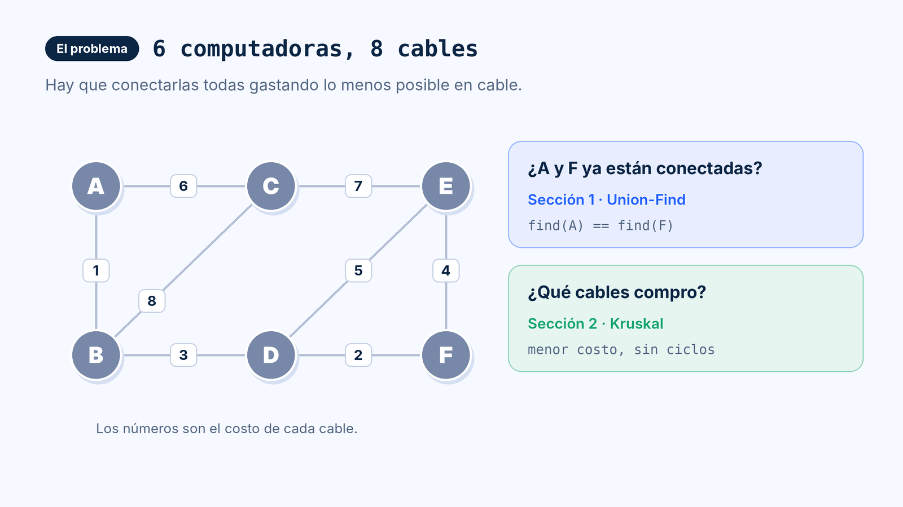

Hay 6 computadoras, de la `A` a la `F`, y 8 cables posibles, cada uno con su
costo. Hay que conectarlas todas gastando lo menos posible.

| Cable | A–B | D–F | B–D | E–F | D–E | A–C | C–E | B–C |
|---|:---:|:---:|:---:|:---:|:---:|:---:|:---:|:---:|
| Costo | 1 | 2 | 3 | 4 | 5 | 6 | 7 | 8 |

Surgen dos preguntas:

1. **¿Estas dos computadoras ya están conectadas?** La responde Union-Find.
   En la **sección 1** instalamos cables a mano, uno por uno, para ver cómo funciona por dentro.
2. **¿Qué cables compro para gastar lo menos posible?** La responde Kruskal.
   En la **sección 2** es el algoritmo el que decide el orden, usando el mismo Union-Find
   para no formar ciclos.

En el código, `A..F` son los índices `0..5` (`ID = {"A": 0, "B": 1, ...}`).
En las tablas, **en negrita** lo que cambia respecto al paso anterior.

---

## Sección 1 · Union-Find


En esta sección **instalamos cables a mano**, uno por uno, y vemos qué le pasa a la
estructura por dentro. En la sección 2 será el algoritmo el que decida el orden.
Las imágenes muestran siempre lo mismo: a la izquierda **la red**, a la derecha
**los conjuntos** y abajo los arreglos `padre` y `rango`.

### Teoría

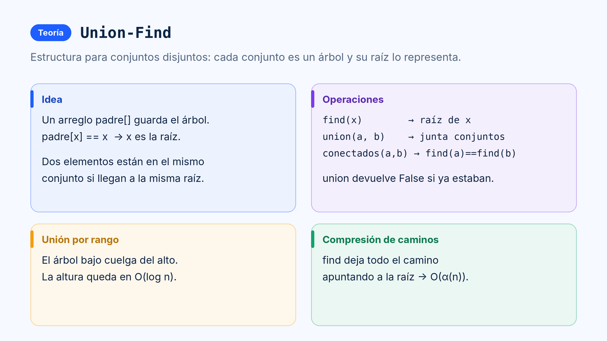

- Cada grupo de computadoras conectadas es un **árbol**; su raíz lo representa.
- `padre[x]` guarda el padre de `x`. Si `padre[x] == x`, `x` es raíz.
- Instalar un cable es `union(a, b)`; preguntar si dos ya están conectadas es
  `conectados(a, b)`, que compara `find(a)` con `find(b)`.
- **Unión por rango:** el árbol bajo cuelga del alto, así la altura queda en `O(log n)`.
- **Compresión de caminos:** `find` deja todo el camino apuntando a la raíz.
  Con las dos, cada operación cuesta `O(α(n))` amortizado.

### El código

[`src/union_find.py`](src/union_find.py)

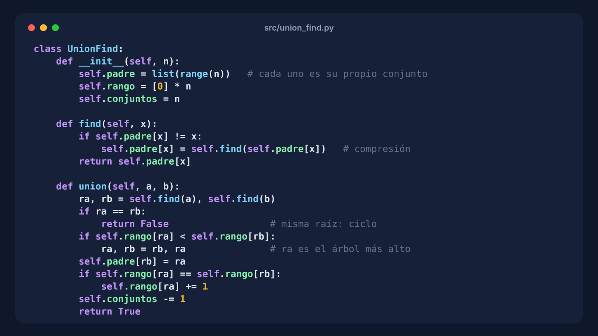

```python
class UnionFind:
    def __init__(self, n):
        self.padre = list(range(n))   # cada uno es su propio conjunto
        self.rango = [0] * n          # cota de la altura de cada árbol
        self.conjuntos = n

    def find(self, x):
        if self.padre[x] != x:
            self.padre[x] = self.find(self.padre[x])   # compresión de caminos
        return self.padre[x]

    def union(self, a, b):
        ra, rb = self.find(a), self.find(b)
        if ra == rb:
            return False                  # ya estaban unidos: sería un ciclo
        if self.rango[ra] < self.rango[rb]:
            ra, rb = rb, ra               # ra es el árbol más alto
        self.padre[rb] = ra
        if self.rango[ra] == self.rango[rb]:
            self.rango[ra] += 1
        self.conjuntos -= 1
        return True

    def conectados(self, a, b):
        return self.find(a) == self.find(b)
```

> **Ojo con `__init__`.** Lleva **dos** guiones bajos de cada lado. Con uno solo
> (`_init_`), Python no lo reconoce como constructor y `UnionFind(6)` falla con
> `TypeError: UnionFind() takes no arguments`.

### Paso 0 · `UnionFind(6)` · ningún cable instalado

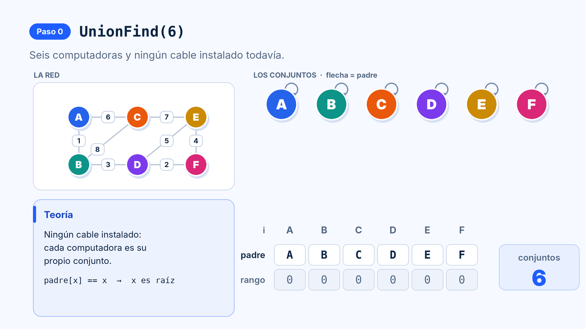

**Teoría:** cada computadora empieza siendo su propio padre y su propio grupo.

| i | A | B | C | D | E | F | conjuntos |
|---|:---:|:---:|:---:|:---:|:---:|:---:|:---:|
| `padre` | A | B | C | D | E | F | **6** |
| `rango` | 0 | 0 | 0 | 0 | 0 | 0 | |

### Paso 1 · cable A–B (1) · `union(A, B)`

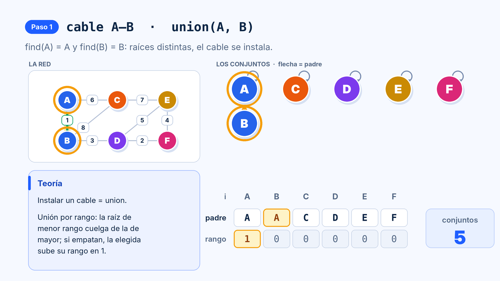

**Teoría (unión por rango):** `union` une raíces. La de menor rango cuelga de la
de mayor; si empatan, se elige una y su rango sube 1.

1. `find(A) = A` y `find(B) = B`. Raíces distintas, el cable sirve.
2. `rango[A] = rango[B] = 0`: no hay intercambio.
3. `padre[B] ← A` y, como empataron, `rango[A]` sube a `1`.

| i | A | B | C | D | E | F | conjuntos |
|---|:---:|:---:|:---:|:---:|:---:|:---:|:---:|
| `padre` | A | **A** | C | D | E | F | **5** |
| `rango` | **1** | 0 | 0 | 0 | 0 | 0 | |

### Paso 2 · cable D–F (2) · `union(D, F)`

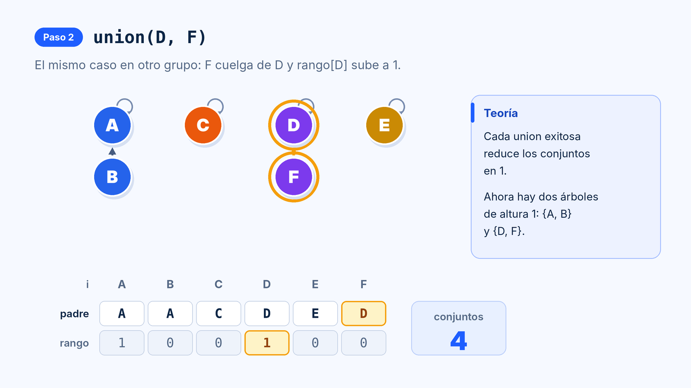

**Teoría:** la red crece como un **bosque**, no como un solo árbol. `{A, B}` y
`{D, F}` son dos grupos todavía separados, y cada `union` exitosa baja
`conjuntos` en 1.

| i | A | B | C | D | E | F | conjuntos |
|---|:---:|:---:|:---:|:---:|:---:|:---:|:---:|
| `padre` | A | A | C | D | E | **D** | **4** |
| `rango` | 1 | 0 | 0 | **1** | 0 | 0 | |

### Paso 3 · cable B–D (3) · `union(B, D)` · se unen raíces, no elementos

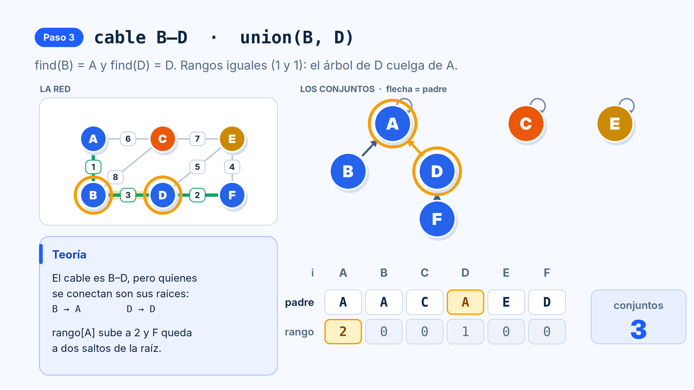

1. `find(B)` sube `B → A`, así que `ra = A`.
2. `find(D) = D`, así que `rb = D`.
3. `rango[A] = rango[D] = 1`: no hay intercambio.
4. `padre[D] ← A`: **el árbol de `D` completo** cuelga de `A`.
5. Como empataron, `rango[A]` sube a `2`.

```
      A          C    E
     / \
    B   D
        |
        F      ← F sigue apuntando a D: está a dos saltos de la raíz
```

| i | A | B | C | D | E | F | conjuntos |
|---|:---:|:---:|:---:|:---:|:---:|:---:|:---:|
| `padre` | A | A | C | **A** | E | D | **3** |
| `rango` | **2** | 0 | 0 | 1 | 0 | 0 | |

### Paso 4 · cable E–F (4) · `union(E, F)` · compresión de caminos

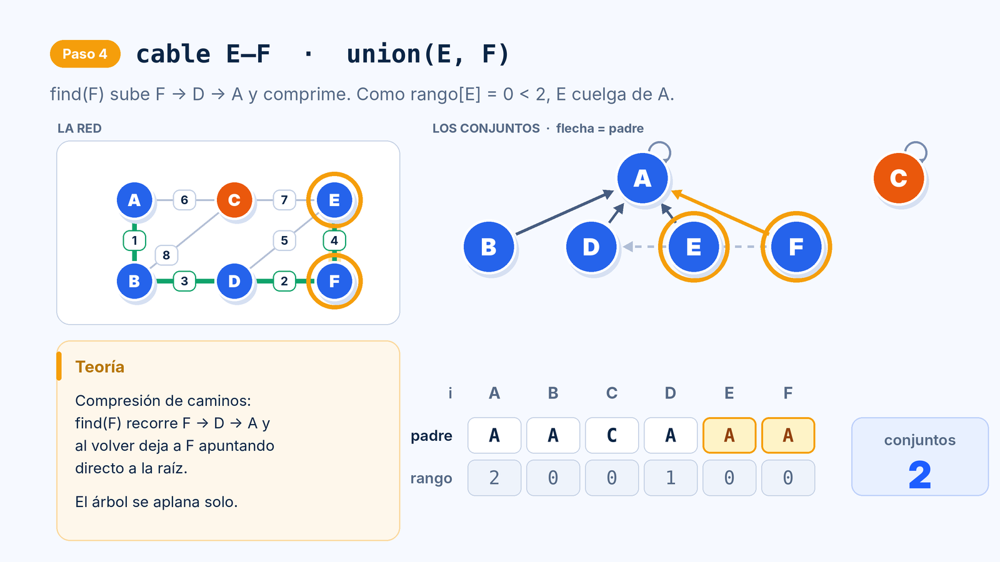

**Teoría:** `padre[x] = find(padre[x])`. La recursión llega a la raíz y, al
regresar, deja a cada nodo del camino apuntando a ella.

1. `find(E) = E`.
2. `find(F)` recorre `F → D → A` y de paso reescribe `padre[F] = A`.
3. `rango[E] = 0 < rango[A] = 2`, así que `E` cuelga de `A` y ningún rango sube.

| i | A | B | C | D | E | F | conjuntos |
|---|:---:|:---:|:---:|:---:|:---:|:---:|:---:|
| `padre` | A | A | C | A | **A** | **A** | **2** |
| `rango` | 2 | 0 | 0 | 1 | 0 | 0 | |

`rango[A]` sigue en `2` aunque la altura real ya es `1`: el rango es una **cota**
de la altura, no la altura exacta.

### Paso 5 · ¿ya están conectadas?

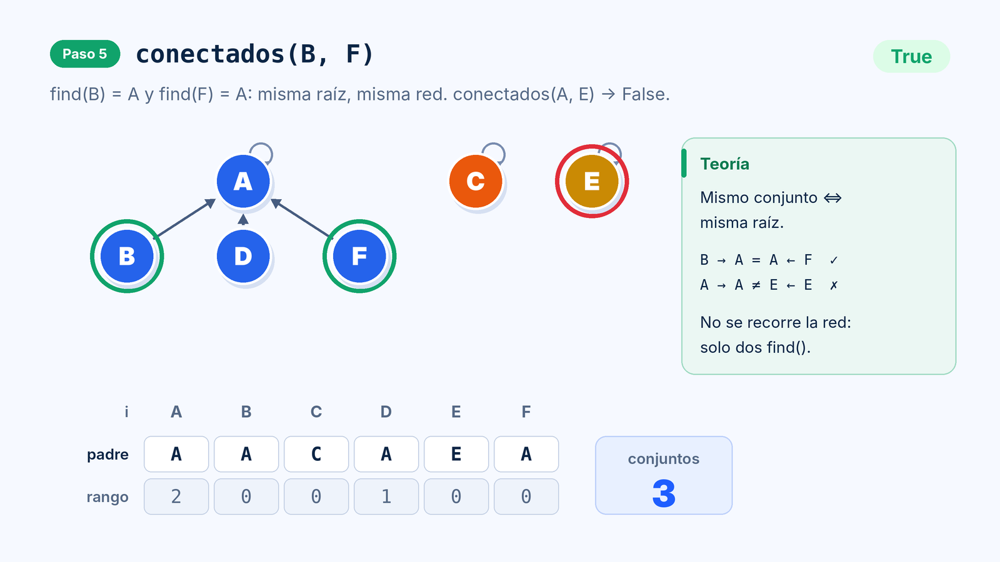

**Teoría:** dos computadoras están en el mismo grupo si y solo si tienen la misma
raíz. No se recorre la red, solo se hacen dos `find`.

- `conectados(B, E)`: `find(B) = A` y `find(E) = A`. Misma raíz: **`True`**.
- `conectados(A, C)`: `find(A) = A` y `find(C) = C`. Raíces distintas: **`False`**.

### Paso 6 · cable D–E (5) · `union(D, E)` regresa `False`

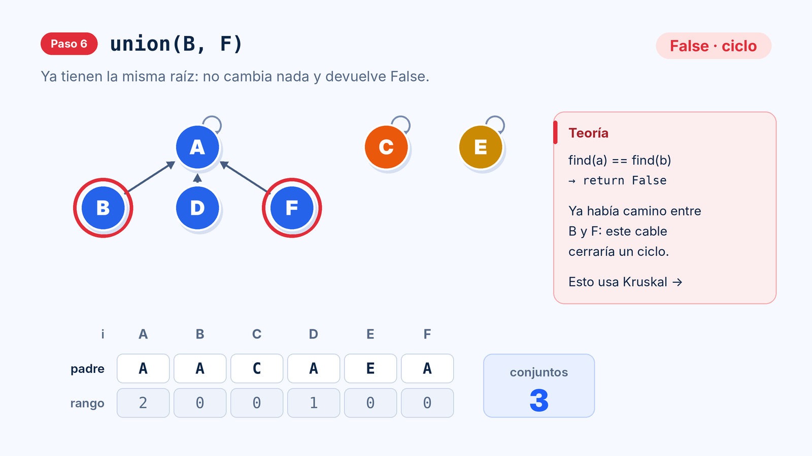

**Teoría:** `find(D) = find(E) = A`, así que ya existe el camino `D–F–E`. Este
cable solo cerraría un **ciclo**: `union` corta en el primer `if` y regresa
**`False`** sin tocar nada. No es un error: es la señal que usa Kruskal para
saltarse un cable que sobra.

### Paso 7 · cable A–C (6) · `union(A, C)` cierra la red

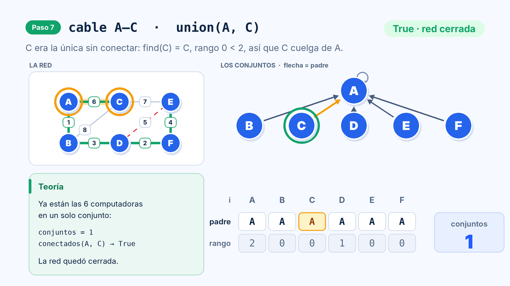

**Teoría:** `find(C) = C` es raíz distinta de `A`, y `rango[C] = 0 < rango[A] = 2`,
así que **C cuelga de A**. `conjuntos` baja a **1**: las 6 computadoras quedan en
un solo conjunto y `conectados(A, C)` ya regresa `True`. Es el mismo cable con el
que Kruskal termina en la sección 2.

### Lo que imprime

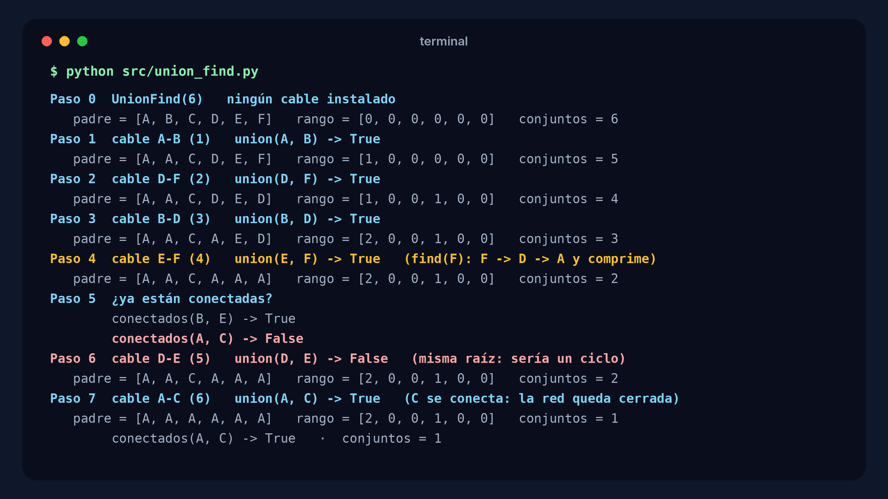

```
$ python src/union_find.py
Paso 0  UnionFind(6)   ningún cable instalado
   padre = [A, B, C, D, E, F]   rango = [0, 0, 0, 0, 0, 0]   conjuntos = 6
Paso 1  cable A-B (1)   union(A, B) -> True
   padre = [A, A, C, D, E, F]   rango = [1, 0, 0, 0, 0, 0]   conjuntos = 5
Paso 2  cable D-F (2)   union(D, F) -> True
   padre = [A, A, C, D, E, D]   rango = [1, 0, 0, 1, 0, 0]   conjuntos = 4
Paso 3  cable B-D (3)   union(B, D) -> True
   padre = [A, A, C, A, E, D]   rango = [2, 0, 0, 1, 0, 0]   conjuntos = 3
Paso 4  cable E-F (4)   union(E, F) -> True   (find(F): F -> D -> A y comprime)
   padre = [A, A, C, A, A, A]   rango = [2, 0, 0, 1, 0, 0]   conjuntos = 2
Paso 5  ¿ya están conectadas?
        conectados(B, E) -> True
        conectados(A, C) -> False
Paso 6  cable D-E (5)   union(D, E) -> False   (misma raíz: sería un ciclo)
   padre = [A, A, C, A, A, A]   rango = [2, 0, 0, 1, 0, 0]   conjuntos = 2
Paso 7  cable A-C (6)   union(A, C) -> True   (C se conecta: la red queda cerrada)
   padre = [A, A, A, A, A, A]   rango = [2, 0, 0, 1, 0, 0]   conjuntos = 1
        conectados(A, C) -> True   ·  conjuntos = 1
```

---

## Sección 2 · Kruskal


### Teoría

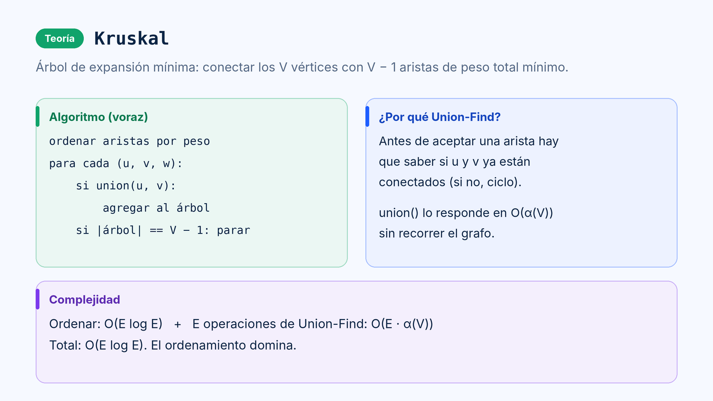

Un **árbol de expansión mínima** conecta los `V` vértices con `V − 1` aristas y
el menor peso total. Kruskal es un algoritmo **voraz**:

```
ordenar las aristas por peso
para cada arista (u, v, w):
    si union(u, v):          # find(u) != find(v): no forma ciclo
        agregarla al árbol
    si el árbol tiene V − 1 aristas: parar
```

Union-Find responde "¿formaría un ciclo?" en `O(α(V))`, sin recorrer el grafo.

### El código

[`src/kruskal.py`](src/kruskal.py), que importa la misma clase `UnionFind`.

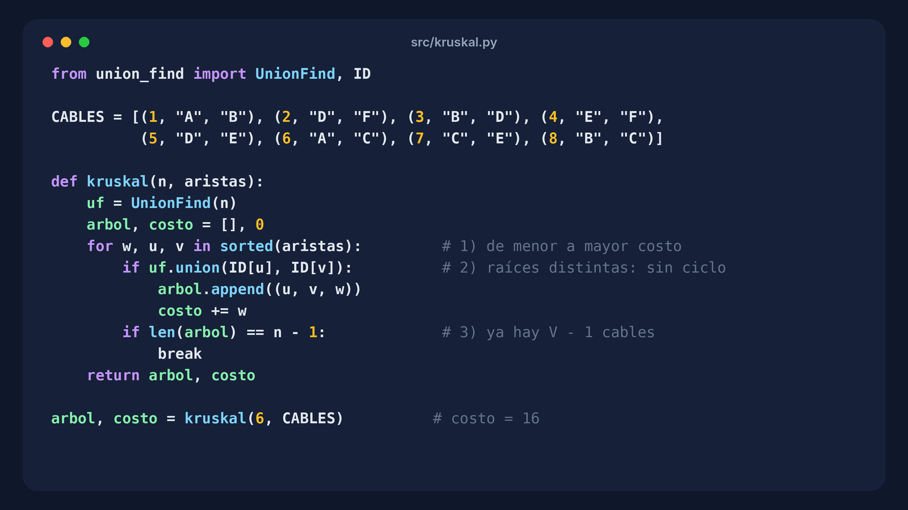

```python
from union_find import UnionFind, NOMBRES, ID

CABLES = [(1, "A", "B"), (2, "D", "F"), (3, "B", "D"), (4, "E", "F"),
          (5, "D", "E"), (6, "A", "C"), (7, "C", "E"), (8, "B", "C")]

def kruskal(n, aristas, verbose=False):
    uf = UnionFind(n)
    arbol, costo = [], 0
    for paso, (w, u, v) in enumerate(sorted(aristas), start=1):   # 1) ordenar
        ru, rv = uf.find(ID[u]), uf.find(ID[v])
        acepta = uf.union(ID[u], ID[v])                             # 2) union decide
        if acepta:
            arbol.append((u, v, w))
            costo += w
        if verbose:
            ...                                                     # imprime el paso
        if len(arbol) == n - 1:                                     # 3) V - 1 aristas
            break
    return arbol, costo
```

### Quién decide qué

Para que los dos algoritmos no se revuelvan, conviene separar sus trabajos. Con
**cada cable** pasa lo mismo, siempre en este orden:

| | Quién | Qué hace |
|:---:|---|---|
| 1 | **Kruskal** | Propone el siguiente cable más barato (por eso se ordenan al inicio). |
| 2 | **Union-Find** | Responde una sola pregunta: ¿`find(u)` y `find(v)` tienen la **misma raíz**? |
| 3 | **Decisión** | Misma raíz: ya hay camino entre ellas, el cable cerraría un ciclo y se **descarta**. Raíces distintas: se **acepta** y `union` junta los dos grupos. |

**Kruskal decide el orden; Union-Find decide el sí o el no.** El costo del cable
solo interviene en el orden en que se preguntan, nunca en la respuesta. Por eso
un cable puede ser barato y aun así rechazarse: `D–E` cuesta 5, pero se descarta
porque `D` y `E` ya estaban conectados.

Al aceptar, `union` cuelga la raíz de menor rango de la de mayor rango (si
empatan, una cuelga de la otra y su rango sube 1).

### Paso 0 · Kruskal ordena los cables

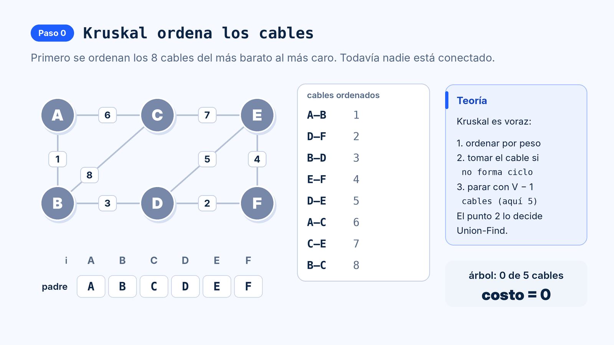

- **Kruskal:** ordena los 8 cables de menor a mayor costo: `A–B (1)`, `D–F (2)`,
  `B–D (3)`, `E–F (4)`, `D–E (5)`, `A–C (6)`, `C–E (7)`, `B–C (8)`.
- **Union-Find:** `UnionFind(6)`. Cada computadora es su propio conjunto.
- **Estado:** `conjuntos = 6` · árbol 0 de 5 · costo 0. Todavía no se decide nada.

### Paso 1 · `A–B (1)` ✓ se acepta

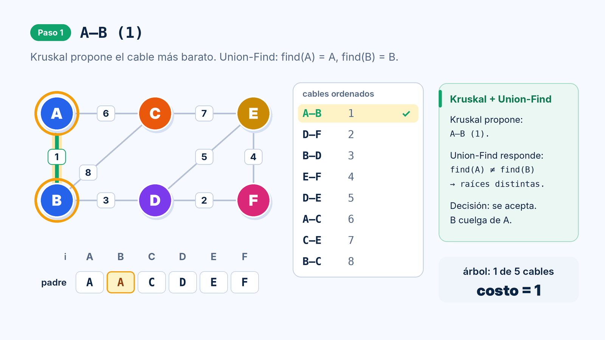

- **Kruskal propone:** `A–B`, el más barato.
- **Union-Find responde:** `find(A) = A` y `find(B) = B`. Raíces distintas: no hay
  camino entre ellas.
- **Decisión:** se acepta. En `union(A, B)` los rangos empatan (0 y 0), `B` cuelga
  de `A` y `rango[A]` sube a 1. Es el paso 1 de la sección 1.
- **Estado:** `conjuntos = 5` · árbol 1 de 5 · costo 1

### Paso 2 · `D–F (2)` ✓ se acepta

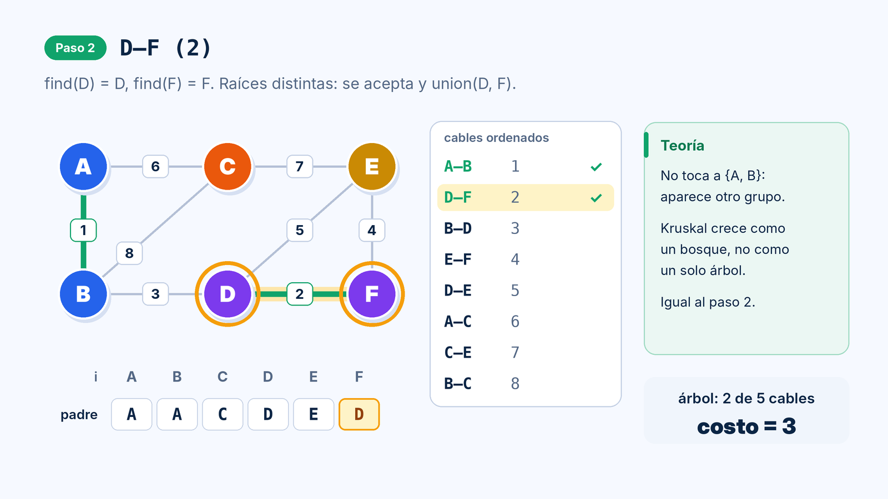

- **Kruskal propone:** `D–F`, el siguiente más barato.
- **Union-Find responde:** `find(D) = D` y `find(F) = F`. Raíces distintas.
- **Decisión:** se acepta. Los rangos empatan, `F` cuelga de `D` y `rango[D]` sube
  a 1. No toca a `{A, B}`: ahora hay **dos árboles separados**, un bosque. Es el
  paso 2 de la sección 1.
- **Estado:** `conjuntos = 4` · árbol 2 de 5 · costo 3

### Paso 3 · `B–D (3)` ✓ se acepta

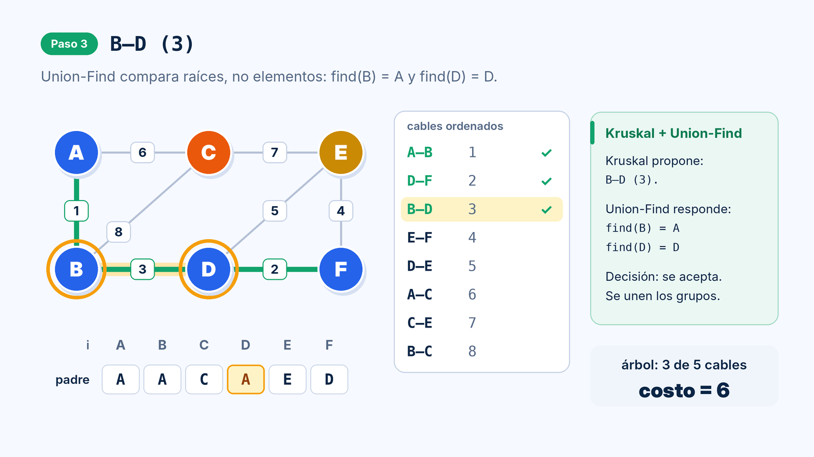

- **Kruskal propone:** `B–D`.
- **Union-Find responde:** `find(B)` sube `B → A` y da `A`; `find(D) = D`. Raíces
  distintas. Se comparan las **raíces**, no los elementos: `B` y `D` no tienen que
  ser raíces.
- **Decisión:** se acepta. Rangos 1 y 1: el árbol de `D` completo cuelga de `A` y
  `rango[A]` sube a 2. Los dos árboles se vuelven uno. Es el paso 3 de la sección 1.
- **Estado:** `conjuntos = 3` · árbol 3 de 5 · costo 6

### Paso 4 · `E–F (4)` ✓ se acepta

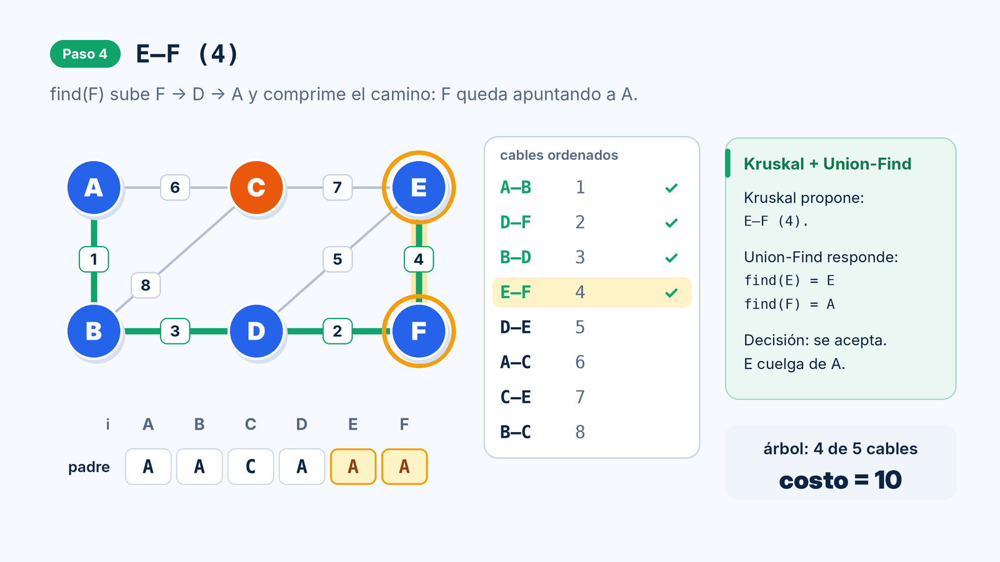

- **Kruskal propone:** `E–F`.
- **Union-Find responde:** `find(E) = E`. `find(F)` recorre `F → D → A` y, de paso,
  **comprime**: `F` queda apuntando a `A`. Raíces distintas (`E` y `A`).
- **Decisión:** se acepta. `rango[E] = 0 < rango[A] = 2`, así que `E` cuelga de `A`
  y ningún rango sube. Es el paso 4 de la sección 1.
- **Estado:** `conjuntos = 2` · árbol 4 de 5 · costo 10

### Paso 5 · `D–E (5)` ✗ se descarta

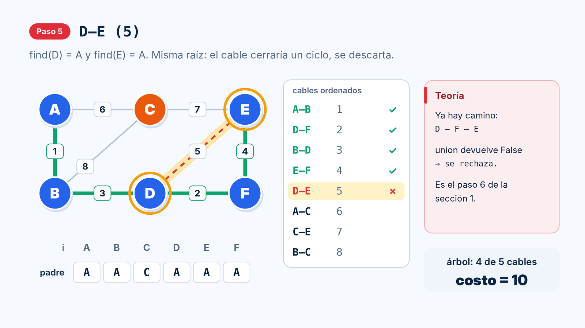

- **Kruskal propone:** `D–E`, que cuesta apenas 5.
- **Union-Find responde:** `find(D) = A` y `find(E) = A`. **Misma raíz**: `D` y `E`
  ya están conectados por `D–F–E`.
- **Decisión:** se descarta. Este cable cerraría un ciclo, así que `union` regresa
  `False` y no cambia nada. Es el paso 6 de la sección 1.
- **Estado:** `conjuntos = 2` · árbol 4 de 5 · costo 10 (sin cambio)

### Paso 6 · `A–C (6)` ✓ se acepta y termina

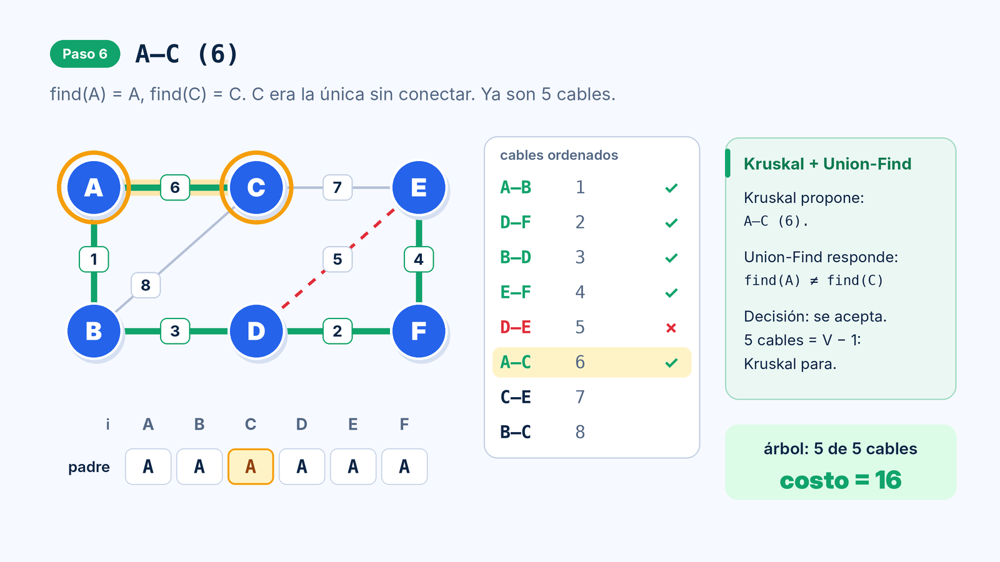

- **Kruskal propone:** `A–C`.
- **Union-Find responde:** `find(A) = A` y `find(C) = C`. Raíces distintas: `C` era la
  única computadora sin conectar.
- **Decisión:** se acepta. `rango[C] = 0 < rango[A] = 2`, así que `C` cuelga de `A`.
  Es el paso 7 de la sección 1.
- **Estado:** `conjuntos = 1` · árbol 5 de 5 · costo 16

Ya hay `V − 1 = 5` cables, así que Kruskal se detiene: `C–E (7)` y `B–C (8)` ni se
le preguntan a Union-Find.

### Resultado

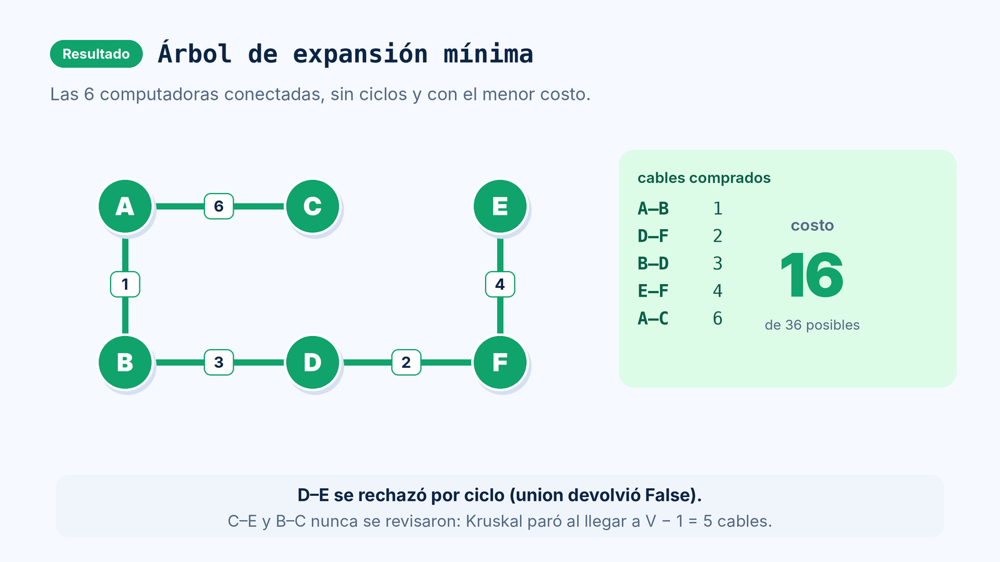

| Paso | Cable | `find(u)` | `find(v)` | Decisión | `padre` después | Costo |
|:---:|:---:|:---:|:---:|:---:|---|:---:|
| 1 | A–B (1) | A | B | ✓ | `[A, `**`A`**`, C, D, E, F]` | 1 |
| 2 | D–F (2) | D | F | ✓ | `[A, A, C, D, E, `**`D`**`]` | 3 |
| 3 | B–D (3) | A | D | ✓ | `[A, A, C, `**`A`**`, E, D]` | 6 |
| 4 | E–F (4) | E | A | ✓ | `[A, A, C, A, `**`A`**`, `**`A`**`]` | 10 |
| 5 | D–E (5) | A | A | ✗ ciclo | sin cambio | 10 |
| 6 | A–C (6) | A | C | ✓ | `[A, A, `**`A`**`, A, A, A]` | **16** |

**Árbol de expansión mínima:** A–B, D–F, B–D, E–F, A–C. **Costo total: 16.**

### Lo que imprime

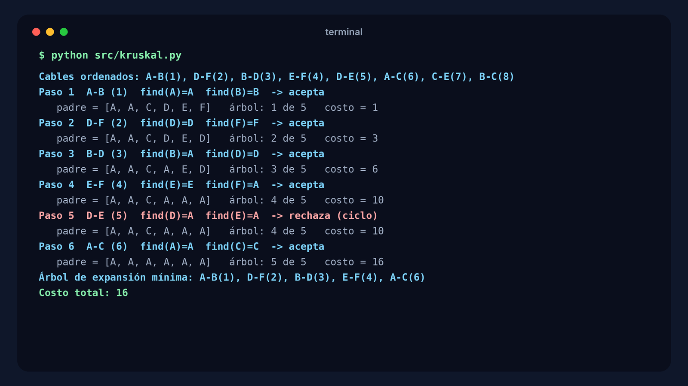

```
$ python kruskal.py
Cables ordenados: A-B(1), D-F(2), B-D(3), E-F(4), D-E(5), A-C(6), C-E(7), B-C(8)
Paso 1  A-B (1)  find(A)=A  find(B)=B  -> acepta
   padre = [A, A, C, D, E, F]   árbol: 1 de 5   costo = 1
Paso 2  D-F (2)  find(D)=D  find(F)=F  -> acepta
   padre = [A, A, C, D, E, D]   árbol: 2 de 5   costo = 3
Paso 3  B-D (3)  find(B)=A  find(D)=D  -> acepta
   padre = [A, A, C, A, E, D]   árbol: 3 de 5   costo = 6
Paso 4  E-F (4)  find(E)=E  find(F)=A  -> acepta
   padre = [A, A, C, A, A, A]   árbol: 4 de 5   costo = 10
Paso 5  D-E (5)  find(D)=A  find(E)=A  -> rechaza (ciclo)
   padre = [A, A, C, A, A, A]   árbol: 4 de 5   costo = 10
Paso 6  A-C (6)  find(A)=A  find(C)=C  -> acepta
   padre = [A, A, A, A, A, A]   árbol: 5 de 5   costo = 16
Árbol de expansión mínima: A-B(1), D-F(2), B-D(3), E-F(4), A-C(6)
Costo total: 16
```

### Pruébalo en la demo interactiva


**[jmbf010907-ui.github.io/-Union-Find-y-Kruskal-](https://jmbf010907-ui.github.io/-Union-Find-y-Kruskal-/)**:
las dos secciones con los mismos pasos, más un modo libre.

### ¿Por qué no recorrer el grafo?

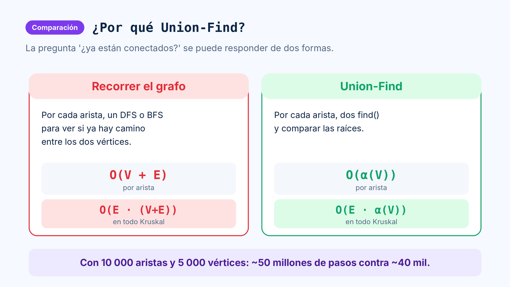

---

# Parte 3 · Análisis de resultados

## 3.1 El experimento

El costo de `find` es la altura del árbol, así que hay que forzar el peor caso:
unir en cadena, `union(0,1)`, `union(1,2)`, `union(2,3)`… y luego hacer `find`
de todos los elementos.

[`src/benchmark.py`](src/benchmark.py) repite el experimento con las cuatro
combinaciones de optimizaciones y mide dos cosas:

- **Saltos de padre:** cuántas veces `find` sube un nivel. Es el trabajo real,
  independiente de la máquina.
- **Tiempo** en segundos.

```bash
python src/benchmark.py 20000
```

## 3.2 Resultados

`n = 20 000` elementos.

> ✏️ Correr el benchmark en la máquina del equipo y **sustituir estos números
> por los propios**. Los saltos deben salir iguales; el tiempo cambia según la
> computadora.

| Configuración | Saltos de padre | Tiempo |
|---|---:|---:|
| Sin optimizaciones | 199 990 000 | 7.72 s |
| Solo compresión de caminos | 39 997 | 0.008 s |
| Solo unión por rango | 39 997 | 0.007 s |
| Compresión + rango | 39 997 | 0.008 s |


## 3.3 Lectura de los resultados

- **Cinco mil veces menos trabajo.** De 200 millones de saltos a 40 mil. Sin
  optimizar, la suma de los `find` es `O(n²)`: `n(n − 1)/2 = 199 990 000`,
  exactamente lo medido. Con cualquier optimización baja a `O(n)`.
- **Con una sola optimización basta para este caso.** Con unión por rango la
  cadena nunca se forma; con compresión, el primer `find` la aplana.
- **Las dos juntas importan en secuencias adversarias**, donde una sola no
  alcanza. Juntas garantizan la cota `O(α(n))` de Tarjan y van Leeuwen.
- **Para Kruskal**, esto significa que detectar ciclos cuesta casi nada y el
  algoritmo queda dominado por ordenar las aristas, `O(E log E)`.

## 3.4 Complejidad

- **Union-Find**, por operación:
  - Sin optimizaciones: `O(n)`. El árbol puede ser una cadena.
  - Solo unión por rango: `O(log n)`. La altura nunca pasa de `log₂ n`.
  - Solo compresión de caminos: `O(log n)` amortizado.
  - **Las dos juntas: `O(α(n))` amortizado.** `α` es la inversa de la función de
    Ackermann; para cualquier `n` que quepa en una computadora, `α(n) ≤ 4`.
  - Espacio: `O(n)`, dos arreglos de `n` enteros.
- **Kruskal**:
  - Ordenar las aristas: `O(E log E)`.
  - `E` llamadas a `union`: `O(E · α(V))`, prácticamente `O(E)`.
  - **Total: `O(E log E)`.** Lo domina el ordenamiento, no la detección de ciclos.
  - Espacio: `O(V + E)`.


---

# Parte 4 · Conclusiones

- Sin optimizaciones, las operaciones se vuelven lentas recorriendo los árboles, tardando más segundos
- Elegir y optimizar la estructura de datos correcta (Union-Find) transforma el rendimiento de un algoritmo voraz como Kruskal
- Con unión por rango y compresión de caminos, aplanamos los árboles y bajamos los saltos en menos segundos 
- El costo por operación queda en un tiempo casi constante O(α(n)). Como Union-Find ya es rapidísimo, lo que más tiempo le toma a Kruskal pasa a ser solo el ordenamiento inicial de las aristas, logrando una eficiencia final de O(E log E)

---

## Referencias

- Cormen, T. H., Leiserson, C. E., Rivest, R. L. y Stein, C. *Introduction to
  Algorithms*. MIT Press. Capítulos de estructuras de datos para conjuntos
  disjuntos y de árboles de expansión mínima. *(Verificar el número de capítulo
  en la edición que use el equipo.)*
- Tarjan, R. E. y van Leeuwen, J. (1984). Worst-case analysis of set union
  algorithms. *Journal of the ACM*, 31(2), 245–281.
- Kruskal, J. B. (1956). On the shortest spanning subtree of a graph and the
  traveling salesman problem. *Proceedings of the American Mathematical
  Society*, 7(1), 48–50.
- Material del curso: Vargas, D. *Estructuras de Datos y Algoritmos II*,
  semestre 2027-1.
